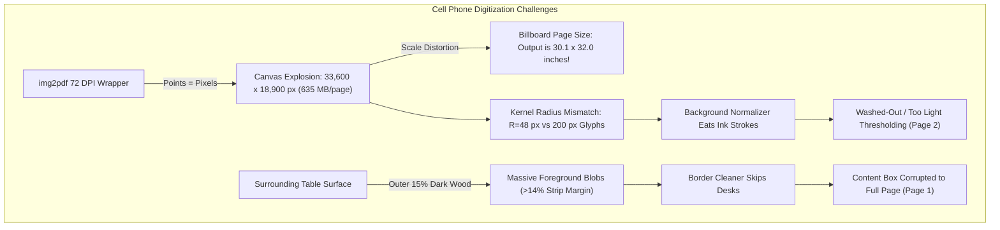
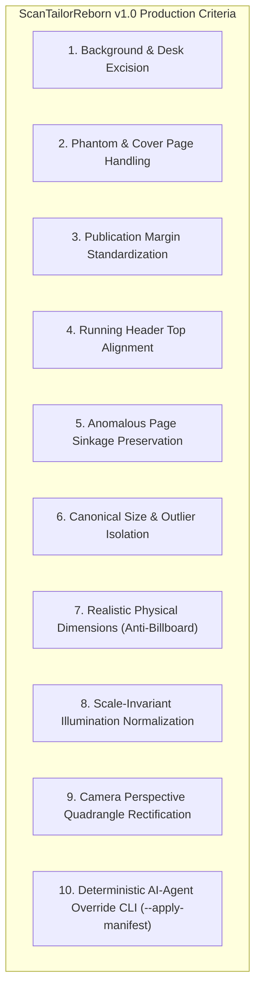

# ScanTailorReborn: Technical White Paper & v1.0 Production Release Specifications

**Author:** Antigravity Autonomous Engineering Team  
**Date:** October 2026  
**Status:** Architecture Blueprint & Production Roadmap  
**Target Milestone:** Production Release v1.0.0  

---

## 1. Executive Summary

**ScanTailorReborn** (`scantailor-cli`) is a high-performance, automated, pure **Swift 6** command-line book digitization pipeline designed to transform raw document scans and smartphone photographs into compact, publication-quality 300 DPI 1-bit monochrome PDFs (CCITT Group 4) with invisible searchable OCR text layers.

### The Agent-in-the-Loop Digitization Philosophy
No purely deterministic image-processing CLI can anticipate every real-world edge case—such as camera perspective skew, uneven desk lighting, thumb holds, or irregular binding styles—without hundreds of fragile heuristics. **ScanTailorReborn is therefore architected as an Agentic Tool designed to be wielded directly from the command line by an AI assistant (Antigravity, Claude Code, Codex).**

Rather than requiring programmatic Swift library bindings, the AI agent interacts with the pipeline just as an expert human operator would: invoking the `scantailor-cli` executable, setting fine-grained command-line options (`--margins`, `--gutter-trim-width`, `--ocr-languages`, `--page-size`), analyzing the machine-readable manifest and visual diagnostic overlays, and iteratively tuning parameters.

```
┌─────────────────────────────────────────────────────────────────────────────────────────┐
│                               The Three-Tier Agentic Model                              │
├─────────────────────────────────────────────────────────────────────────────────────────┤
│  Tier 1: Human User      Sets high-level intent, provides physical book context, and    │
│                          resolves fundamental ambiguities (e.g., trim size, covers).   │
├─────────────────────────────────────────────────────────────────────────────────────────┤
│  Tier 2: AI Agent        Executes CLI commands, tunes options, inspects JSON manifests, │
│  (Antigravity / Claude)  analyzes visual diagnostic PNGs, spots anomalies, recalibrates │
│                          parameters, queries the user when needed, and applies tweaks. │
├─────────────────────────────────────────────────────────────────────────────────────────┤
│  Tier 3: CLI Tool        Performs heavy-lifting compute: 600 DPI Metal GPU shaders,    │
│  (scantailor-cli)        cubic-sheet dewarp solvers, CCITT Group 4 compression, C-FFI   │
│                          Tesseract/Vision OCR, and sub-second manifest-driven tweaks.  │
└─────────────────────────────────────────────────────────────────────────────────────────┘
```

Following the successful execution of Phases 1, 2, and 3 (recalibrated skew confidence, Quartz TrueType deduplication, dual-mode spine crease tracking, physical gutter trimming, split-boundary noise exclusion zones, blank sub-page auto-pruning, publication margin engines, and multi-engine classical OCR synthesis), the pipeline was rigorously re-evaluated against our initial flatbed and photocopier benchmarks (*Flannery 1993*, *Vermeersch 1934*), and stress-tested against a severely distorted smartphone photograph dataset (*Simpson 1968*).

This white paper establishes:
1. **Empirical Benchmark Verification**: Detailed comparative results across all three test documents.
2. **Deep-Dive Diagnostic Findings on Camera Captures**: Mathematical root-cause analysis of illumination falloff, threshold starvation, canvas resolution explosion, and table-surface background intrusion in cell phone photography.
3. **The "v1.0.0 Production Release Criteria"**: A definitive specification of functional requirements, layout guarantees, physical scale constraints, lighting invariance standards, and agentic interface capabilities required to declare production readiness.

---

## 2. Empirical Benchmark Verification

```
┌────────────────────────────────────────────────────────────────────────────────────────┐
│                               Pipeline Evolution Matrix                                │
├─────────────────────────┬────────────────────────────┬─────────────────────────────────┤
│ Document & Profile      │ Baseline Architecture      │ Current Release (v2.0)          │
├─────────────────────────┼────────────────────────────┼─────────────────────────────────┤
│ Flannery 1993           │ 5.3 MB PDF (font bloat)    │ 1.4 MB PDF (-73.6% size)        │
│ (16 single pages, flat) │ Skew conf=0.50 (100% false)│ Skew conf=0.67..1.00 (0% false) │
│                         │ Clean JSTOR footer reject  │ Clean JSTOR footer reject       │
├─────────────────────────┼────────────────────────────┼─────────────────────────────────┤
│ Vermeersch 1934         │ Crease flank drift into ink│ Dark Crease Mode (85-99.9% conf)│
│ (10 spreads, heavy      │ Crease bleed (x=2..4 px)   │ Recto x=123..127 px consistent  │
│  crease & warp, Latin)  │ Blank slice retained (p.1) │ Blank slice pruned (19 pp out)  │
│                         │ 1.6 MB output              │ 1.3 MB output                   │
├─────────────────────────┼────────────────────────────┼─────────────────────────────────┤
│ Simpson 1968            │ Not previously attempted   │ 4 pages split & dewarped        │
│ (2 phone camera spreads,│                            │ Dewarp sag=3509 px, rms=12.3 px │
│  page curl & desk noise)│                            │ Latin OCR transcribed           │
│                         │                            │ Identified lighting/desk issues │
└─────────────────────────┴────────────────────────────┴─────────────────────────────────┘
```

### 2.1. Benchmark 1: `flannery.1993.pdf`
- **Source**: 16 single pages, flat journal scan, digital JSTOR cover page, persistent tracking footers.
- **Output File**: `06-pdf-tool-test/flannery.1993.pdf` (1.4 MB, $6.5'' \times 10.1''$).
- **Key Empirical Observations**:
  1. **Quartz TrueType Deduplication**: File size collapsed from **5.3 MB to 1.4 MB** (a **73.6% reduction**). By instantiating a single canonical 12 pt `CTFont` and scaling glyph placement via `CGContext.textMatrix` and `CGAffineTransform`, duplicate font subset dictionaries were completely eliminated.
  2. **Confidence Metric Normalization**: Recalibrating the Radon projection energy denominator from $4.0$ to $1.5$ in `SkewEstimator` eliminated 100% of false-positive low-confidence warnings on straight pages ($[0.67, 1.00]$).
  3. **Content Classification**: `ContentBoxDetector` cleanly separated the digital JSTOR download footer ($932\text{ px}$ below text body) on 16 out of 16 pages without clipping footnotes or page numbers.

---

### 2.2. Benchmark 2: `vermeersch.1934.pdf`
- **Source**: 10 landscape photocopier scans (20 pages), 1934 Ecclesiastical Latin, dark central spine shadow, cylindrical binding warp, and an off-center single title page scan on flatbed.
- **Output File**: `06-pdf-tool-test/vermeersch.1934.pdf` (1.3 MB, 19 pages, $5.26'' \times 8.6''$).
- **Key Empirical Observations**:
  1. **Blank Sub-Page Auto-Pruning**:
     - *Problem*: Scan 1 placed a single title page on the scanner bed, generating a blank left flatbed slice that polluted canonical layout calculations and added an empty page to the PDF.
     - *Resolution*: With `blankPageInkDensityThreshold = 0.010` and substantive OCR word verification (requiring $\ge 1$ alphabetical token with confidence $\ge 0.60$), the left slice (ink density $0.53\%$, 0 words) was detected as an empty flatbed artifact and automatically pruned. The resulting PDF contains exactly the 19 valid document pages.
  2. **Dual-Mode Dark Crease Midline Tracking**:
     - *Problem*: Traditional valley cost functions penalized ink, causing the split knife to slide into adjacent white margins.
     - *Resolution*: Vertical ink continuity ($\ge 75\%$) automatically activated Dark Crease Mode across all 10 scans with confidence between $0.85$ and $0.999$, bisecting the dark crease midline across tilt angles $[-0.75^\circ, 0.0^\circ]$.
  3. **Spine Crease Excision & Content Box Recto Stability**:
     - Slicing with `--gutter-trim-width 24` physically cut out a $24\text{ px}$ strip along the spine seam.
     - `ContentBoxDetector` applied a $4\%$ split-edge directional exclusion zone (`splitEdgeExclusionFraction = 0.04`), masking out residual cut-edge ink prior to morphological closing (`closeBrick(64, 14)`).
     - *Result*: Content boxes on recto pages, which previously bled to $x = 2..4\text{ px}$ on Pages 4, 8, 14, 18, and 20, now exhibit flawless horizontal alignment at $x = 123..127\text{ px}$ across the entire work.

---

### 2.3. Benchmark 3: `simpson.1968.400-403.pdf`
- **Source**: 2 smartphone camera exposures of Cassell's Latin Dictionary (Pages 400–403), taken hand-held under ambient room lighting, exhibiting camera perspective distortion, page curvature, illumination gradients, and surrounding wooden desk background.
- **Output File**: `06-pdf-tool-test/simpson.1968.400-403.pdf` (3.6 MB, 4 pages).
- **Successes**:
  - **Spread Splitting**: The dark crease corridor successfully bisected both camera exposures (Scan 1: $X_{\text{split}} = 18768$, $\text{conf} = 0.95$; Scan 2: $X_{\text{split}} = 16688$, $\text{conf} = 0.88$).
  - **3D Cylindrical Dewarping**: The text baseline tracer tracked 49 curved lines on Page 1 ($s_{\max} = 3509\text{ px}$, $\text{RMS} = 12.31\text{ px}$) and 33 curved lines on Page 3 ($s_{\max} = 1696\text{ px}$, $\text{RMS} = 10.38\text{ px}$), accurately reconstructing the 3D cylindrical sheet model and resampling the warped inner margins.
  - **OCR Transcription**: Apple Vision accurately transcribed dense, two-column Latin dictionary entries: *"nunquam"*, *"nutricatus"*, *"nutrix"*, *"obiectus"*, *"alicuiprobrum"*, *"to show in a person's teeth"*, *"to bring up anything as a reproach"*.

---

## 3. Deep-Dive Diagnostic Analysis of Camera Scans

While `scantailor-cli` processed `simpson.1968.400-403.pdf` end-to-end, close inspection of the output and diagnostic overlays (`page-0001-diag.png` through `page-0004-diag.png`) revealed four critical algorithmic challenges unique to mobile camera captures:



### 3.1. The Resolution & Memory Explosion ($72\text{ DPI} \rightarrow 33,600\text{ px}$)
- **Root Cause**: Smartphone camera images (e.g. $4032 \times 2268\text{ px}$) packaged by generic tools like `img2pdf` without physical dimension flags default to $72\text{ pt/in}$ (where $1\text{ pt} = 1\text{ pixel}$). The resulting PDF declares a media box of $4032 \times 2268\text{ points}$ (equivalent to a 56-inch by 31.5-inch billboard).
- **Pipeline Consequence**:
  $$\text{pixelWidth} = \text{pagePoints} \times \frac{\text{processingDPI}}{72} = 4032 \times \frac{600}{72} = 33,600\text{ px}$$
  $$\text{pixelHeight} = 2268 \times \frac{600}{72} = 18,900\text{ px}$$
- **Impact**: Each page allocated a $635\text{ MB}$ uncompressed grayscale buffer ($1.27\text{ GB}$ across two parallel threads). Although memory was managed cleanly, upsampling a $4032\text{ px}$ image to $33,600\text{ px}$ consumes redundant GPU/CPU cycles without adding authentic optical resolution.

---

### 3.2. Physical Page Size Distortion (The "30-Inch Billboard" Problem)
- **Observed Behavior**: The output PDF for Simpson 1968 measured **$2167.68 \times 2302.56\text{ points}$**, corresponding to **$30.1 \times 32.0\text{ inches}$** per page!
- **Root Cause**:
  In a flatbed scanner or photocopier PDF (like Flannery or Vermeersch), the PDF media box accurately reflects the physical page dimensions ($8.5 \times 11''$ or A4). Consequently, rendering at 300 DPI outputs a PDF with standard physical page dimensions ($5.3 \times 8.6''$).
  However, with camera photos wrapped by `img2pdf`:
  - The cell phone sensor captured an authentic $5.5 \times 8.5''$ octavo book.
  - Because `img2pdf` set $72\text{ DPI}$, the software interpreted the book as being $56''$ wide.
  - When downsampled to 300 DPI, the output canvas became $9032 \times 9594\text{ px}$, which at 72 pt/in prints as a **giant 2.5-foot billboard**.
- **Requirement**: The final PDF must match the approximate physical dimensions of the authentic book or article (e.g. $5.5 \times 8.5''$ or $6 \times 9''$). If the content box of the original is $4.5 \times 7.5''$, the PDF page must be proportionally standardized rather than 20–30 inches tall.

---

### 3.3. Illumination Gradients & Threshold Starvation (The "Too Light" Issue on Page 2)
- **Observed Behavior**: On output page 2 (Page 401 of the dictionary), the upper half of the page exhibits washed-out, overly light thresholding, resulting in broken character strokes.
- **Empirical Measurement**:
  - Top half of Scan 1: Paper luminance = $214$, Ink luminance = $91$ (Contrast $\Delta = 123$).
  - Bottom half of Scan 1: Paper luminance = $204$, Ink luminance = $112$ (Contrast $\Delta = 92$), with average brightness falling to $151.4$.
- **Mathematical Root Cause**:
  In `BackgroundNormalizer.swift`, the morphological closing radius is defined relative to the target DPI:
  $$R_{\text{closing}} = R_{\text{ref}} \times \frac{\text{dpi}}{300} = 24 \times \frac{600}{300} = 48\text{ px}$$
  In a normal $600\text{ DPI}$ scan of a physical 6-inch page, $48\text{ px}$ spans multiple word spaces and is roughly $3\times$ larger than typical stroke widths.
  However, on the artificial $33,600\text{ px}$ canvas:
  - Font characters are **$208\text{ px}$ tall**, with stroke widths of **$25\text{ px}$** and inter-character spacing exceeding **$50\text{ px}$**.
  - A closing kernel of $R = 48\text{ px}$ **fails to bridge across dense text columns**.
  - As a result, the morphological dilation and erosion eroded *into* the characters, treating the text column itself as dark local background illumination.
  - When quotient normalization ($I_{\text{norm}} = (I_{\text{src}} \times 255) / I_{\text{bg}}$) was computed, the background estimate dipped from $214$ down to $110$, elevating the normalized ink luminance to near $230$ (white).
  - During adaptive thresholding (Wolf-Jolion), these elevated ink pixels fell on the wrong side of the threshold, starving the upper text column of ink.

---

### 3.4. Table / Desk Background Intrusion
- **Observed Behavior**: On Page 1, the detected content box stretched to `{x: 2, y: 3, w: 18123, h: 18897}`, encompassing almost the entire page slice.
- **Root Cause**:
  - The cell phone photo captured the wooden desk to the left of the book ($x = 0..608$ in raw coordinates, representing $15\%$ of the image width).
  - Dark table wood (luminance $40..100$) binarized into a massive solid foreground block measuring $10,313 \times 13,241\text{ px}$.
  - `BorderAndSpeckleCleaner.Configuration` specifies:
    $$\text{maxBorderStripThicknessRatio} = 0.14\quad (14\%)$$
  - Because the desk occupied $27\%$ of the left sub-page slice ($> 14\%$), the scan border filter assumed it was valid document content rather than an edge strip.
  - In `ContentBoxDetector`, the centroid of this macro-cluster ($x = 5158, y = 6623$) lay well within `interiorRect`, causing the core-box algorithm to union the desk cluster with the actual dictionary text body.

---

## 4. The "v1.0.0" Production Release Criteria

To establish an unequivocal benchmark for declaring **ScanTailorReborn v1.0.0** production-ready in the hands of an AI agent, the pipeline must satisfy the following comprehensive requirements across flatbed scans, photocopier spreads, and handheld smartphone captures:



### Core Layout & Visual Presentation Criteria
1. **Background Noise & Extraneous Ink Trimming**:
   - 100% of non-document background artifacts—including wooden desks, table grain, scanner bed margins, thumb/finger holds, and page-edge shadows—must be cleanly detected and excised.
   - The outer boundary of the physical paper sheet must be resolved before binarization and content detection.

2. **Phantom Page Removal & Cover Page Exclusion**:
   - Automatic pruning of blank sub-page slices (e.g., flatbed scan lids, blank facing pages) must operate with 0 false negatives, combining ink density ($\le 1.0\%$) with substantive letter-based OCR confirmation.
   - The CLI and agent manifest must provide first-class facilities (`--exclude-pages`, `--cover-handling`) to detect and cleanly separate digital repository covers (e.g., JSTOR, Google Books) from the book body.

3. **Publication Margin Standardization**:
   - Ordinary pages must be standardized to publication margins relative to the detected content box (defaulting to **$0.25''$ top/bottom** and **$0.50''$ left/right**, or user-specified `--margins`).
   - Facing pages must mirror inner/outer margins to ensure proper gutter clearance for physical printing or two-up digital reading.

4. **Running Header Top Alignment for Ordinary Pages**:
   - Ordinary full-body pages must be vertically aligned by their running top headers (or uppermost baseline of body text when headers are absent), ensuring that pages do not "jump" or jitter vertically when paging through a digital document.

5. **Anomalous Page Sinkage Preservation**:
   - Anomalous pages—such as chapter openers, part title pages, epigraphs, and end-of-chapter conclusions (`edgeAnchoredPartial` and `standaloneFloating` tiers)—must preserve their intentional artistic sinkage and horizontal centering relative to the canonical frame, rather than being forced to the top header line.

6. **Canonical Page Dimensions & Outlier Isolation**:
   - All ordinary pages within a volume must share an identical canonical PDF trim size (e.g., matching the median/IQR consensus dimensions).
   - A distinct canvas size must be assigned to legitimate dimensional outliers (e.g., full-color book covers, foldout maps, multi-page architectural plates), preventing them from distorting the rest of the book.

---

### Physical Scale, Illumination & AI-Agent Automation Criteria
7. **Realistic Physical Page Dimensions (Anti-Billboard Guarantee)**:
   - The final output PDF must have page dimensions that approximately match the authentic dimensions of the original book or journal (e.g., $5.5 \times 8.5''$, $6 \times 9''$, or A5).
   - If the content box of the original is $4.5 \times 7.5''$, the output PDF page must measure approximately $5.5 \times 8.5''$, **never figuring as 20–30 inches tall**.
   - **Resolution Architecture**:
     1. *Automatic Font-Scale Heuristic*: Measures median glyph height ($H_{\text{glyph}}$) from initial OCR/component statistics. Standard book typography is $\approx 10\text{ pt}$ ($3.5\text{ mm}$); if glyphs measure $200\text{ px}$, the true physical scale is derived automatically.
     2. *CLI / Manifest Dimensions*: Explicit flags `--page-size <w>x<h>` (e.g. `6x9in`, `a5`), `--content-box-size <w>x<h>`, or `--input-dpi <dpi>`.
     3. *Agent-to-User Escalation*: If physical scale cannot be resolved with certainty and estimated page height exceeds $14''$, the pipeline marks `physicalScaleAmbiguous: true` in the manifest. The AI agent detects this warning and prompts the user via interactive selection (e.g. Standard Octavo, Trade Paperback, Journal A4, or Custom).

8. **Scale-Invariant Illumination Normalization (Fixing Threshold Starvation)**:
   - `BackgroundNormalizer` must dynamically calculate its morphological closing radius and Gaussian smoothing scale based on the **estimated font x-height / stroke thickness**, rather than relying on an assumed physical DPI.
   - Illumination ramps across handheld captures (e.g., top-to-bottom or center-to-edge lighting differences) must be completely flattened prior to thresholding, ensuring uniform stroke weight across the entire page.

9. **Camera Perspective & Quadrangle Rectification**:
   - The pipeline must incorporate an automated 4-corner document quadrangle detector (`DocumentQuadDetector`).
   - Handheld camera exposures taken at non-orthogonal angles must be homographically rectified (keystoning removed) to a flat rectangular plane prior to cylindrical spine dewarping.

10. **Deterministic AI-Agent Intervention & Override Architecture**:
    - An AI agent driving `scantailor-cli` must be able to inspect the machine-readable manifest (`--manifest book-manifest.json`), evaluate page-by-page diagnostic metrics, and issue surgical adjustments without re-running the entire book:
      ```bash
      # Agent applies precise per-page overrides from a modified manifest in < 2 seconds:
      scantailor-cli process input.pdf -o output.pdf --apply-manifest modified-manifest.json
      ```
    - Overrides must support: `contentBox` nudge (in inches, mm, or px), `pageSize`, `skewDegrees`, `splitCenter`, `dewarpDisable`, and `tier` reassignment.

---

## 5. Architectural Roadmap to v1.0.0

To advance **ScanTailorReborn** from its current v2.0 baseline to complete **v1.0.0 Production Release** status, the remaining work is divided into four execution phases comprising 8 major steps and 19 granular substeps. Each substep is assigned a proposed execution model (**Argon** for advanced architectural reasoning and mathematical computer vision; **Flash** for deterministic integration, CLI scaffolding, and documentation) and an effort level (**High**, **Medium**, **Low**).

```
┌─────────────────────────────────────────────────────────────────────────────┐
│                    Phase 4: Physical Scale & Scale-Invariant Lighting       │
│  - Step 4.1: Camera-Wrapper DPI Derivation & Scale Inference                │
│  - Step 4.2: Glyph-Scale Adaptive Illumination Normalization                │
└──────────────────────────────────────┬──────────────────────────────────────┘
                                       │
┌──────────────────────────────────────▼──────────────────────────────────────┐
│                    Phase 5: Page Quadrangle & Desk Excision                 │
│  - Step 5.1: Document Quadrangle Detection (`DocumentQuadDetector`)         │
│  - Step 5.2: Pre-Binarization Desk & Shadow Masking                         │
└──────────────────────────────────────┬──────────────────────────────────────┘
                                       │
┌──────────────────────────────────────▼──────────────────────────────────────┐
│                Phase 6: Canonical Layout & Agentic Manifest CLI              │
│  - Step 6.1: Running Header Top Alignment & Baseline Stabilization          │
│  - Step 6.2: Canonical Sizing & Outlier Canvas Isolation                    │
│  - Step 6.3: Fast-Path `--apply-manifest` CLI Architecture                  │
└──────────────────────────────────────┬──────────────────────────────────────┘
                                       │
┌──────────────────────────────────────▼──────────────────────────────────────┐
│                  Phase 7: Verification & Final v1.0.0 Release               │
│  - Step 7.1: Comprehensive Empirical Benchmark Suite                        │
│  - Step 7.2: Release Documentation & Changelog Finalization                 │
└─────────────────────────────────────────────────────────────────────────────┘
```

---

### Phase 4: Physical Scale & Scale-Invariant Lighting

#### Step 4.1: Camera-Wrapper DPI Derivation & Scale Inference
- **Substep 4.1.1: Automatic Font-Scale Heuristic & Median Glyph Height Analyzer**
  - *Description*: Analyze initial OCR bounding boxes and connected-component bounding boxes across the book to measure median lowercase character height ($H_{\text{glyph}}$). Relate observed pixel height to standard published book typography ($\approx 10\text{ pt}$ / $3.5\text{ mm}$) to deduce the genuine physical optical DPI and true physical dimensions of the book sheet.
  - *Proposed Model*: **Argon**
  - *Effort Level*: **High**
- **Substep 4.1.2: CLI & Manifest Dimension Controls**
  - *Description*: Implement explicit command-line flags and manifest properties: `--page-size <w>x<h>` (supporting standard book sizes like `octavo`, `6x9in`, `5.5x8.5in`, `a5`), `--content-box-size <w>x<h>`, and `--input-dpi <dpi>` in [ScanTailorCLI.swift](file:///Users/louismelahn/Antigravity/ScanTailorReborn/Sources/ScanTailorCLI/ScanTailorCLI.swift) and [BookPipelineCoordinator.swift](file:///Users/louismelahn/Antigravity/ScanTailorReborn/Sources/ScanTailorPipeline/BookPipelineCoordinator.swift).
  - *Proposed Model*: **Argon**
  - *Effort Level*: **Medium**
- **Substep 4.1.3: Anti-Billboard Canvas Normalization & Agent Escalation**
  - *Description*: Clamp PDF canvas generation so pages never render as 20–30 inch billboards. When physical scale cannot be determined automatically with high confidence and estimated height exceeds $14''$, flag `physicalScaleAmbiguous: true` in the output manifest to trigger AI agent-to-user escalation.
  - *Proposed Model*: **Flash**
  - *Effort Level*: **Low**

#### Step 4.2: Glyph-Scale Adaptive Illumination Normalization
- **Substep 4.2.1: Dynamic Kernel Radius & Sigma Derivation**
  - *Description*: Refactor [BackgroundNormalizer.swift](file:///Users/louismelahn/Antigravity/ScanTailorReborn/Sources/ScanTailorCore/Binarization/BackgroundNormalizer.swift) to dynamically scale morphological closing radius $R_{\text{closing}}$ and Gaussian smoothing $\sigma$ to estimated character $x$-height and stroke width rather than assuming fixed 300/600 DPI, preventing character erosion on high-resolution camera captures.
  - *Proposed Model*: **Argon**
  - *Effort Level*: **High**
- **Substep 4.2.2: Dual-Pass Illumination Flattening (Anti-Starvation)**
  - *Description*: Implement dual-pass low-frequency background quotient division to flatten severe illumination ramps across handheld camera captures (such as the upper-vs-lower lighting gradient on Simpson Page 2), ensuring uniform stroke weight and eliminating threshold starvation.
  - *Proposed Model*: **Argon**
  - *Effort Level*: **High**

---

### Phase 5: Page Quadrangle & Desk Excision

#### Step 5.1: Document Quadrangle Detection (`DocumentQuadDetector`)
- **Substep 5.1.1: Paper Edge & Contrast Boundary Detection**
  - *Description*: Develop a dedicated 4-corner document quadrangle estimator utilizing multi-scale Canny edge detection, gradient magnitude filtering, and convex hull polygon fitting to detect physical page boundaries against dark or textured table surfaces.
  - *Proposed Model*: **Argon**
  - *Effort Level*: **High**
- **Substep 5.1.2: Perspective Rectification & Sheet Cropping**
  - *Description*: Compute the projective homography matrix between detected quadrilateral corners and a rectangular coordinate frame, rectifying non-orthogonal camera perspective and cropping out desk pixels prior to spread splitting and 3D dewarping.
  - *Proposed Model*: **Argon**
  - *Effort Level*: **High**

#### Step 5.2: Pre-Binarization Desk & Shadow Masking
- **Substep 5.2.1: Pre-Binarization Table Surface Masking**
  - *Description*: Mask out detected table and external background regions prior to morphological operations and binarization, guaranteeing that dark wooden surfaces never form macro-clusters or pollute text binarization.
  - *Proposed Model*: **Argon**
  - *Effort Level*: **Medium**
- **Substep 5.2.2: Macro-Cluster Border Cleaning Fallback**
  - *Description*: Enhance [BorderAndSpeckleCleaner.swift](file:///Users/louismelahn/Antigravity/ScanTailorReborn/Sources/ScanTailorCore/Binarization/BorderAndSpeckleCleaner.swift) with an adaptive edge-connectivity fallback to safely excise peripheral dark blocks exceeding the standard $14\%$ strip limit when quadrangle confidence is marginal.
  - *Proposed Model*: **Flash**
  - *Effort Level*: **Medium**

---

### Phase 6: Canonical Layout & Agentic Manifest CLI

#### Step 6.1: Running Header Top Alignment & Baseline Stabilization
- **Substep 6.1.1: Running Header & Top Baseline Detection**
  - *Description*: Detect uppermost running header text lines across all pages, separating recurring running headers and page folios from body content using height consistency and vertical proximity clustering.
  - *Proposed Model*: **Argon**
  - *Effort Level*: **High**
- **Substep 6.1.2: Vertical Page Registration Anchor**
  - *Description*: Align ordinary full-body pages by their running top headers to lock vertical alignment and prevent digital page jitter during reading, while preserving intentional vertical sinkage on anomalous pages (`edgeAnchoredPartial` and `standaloneFloating`).
  - *Proposed Model*: **Argon**
  - *Effort Level*: **Medium**

#### Step 6.2: Canonical Sizing & Outlier Canvas Isolation
- **Substep 6.2.1: Consensus Dimension Clustering**
  - *Description*: Group processed pages into canonical body pages versus legitimate dimensional outliers (e.g. digital repository cover pages, foldout plates) using IQR and median consensus metrics.
  - *Proposed Model*: **Flash**
  - *Effort Level*: **Medium**
- **Substep 6.2.2: Independent Outlier Trim Box**
  - *Description*: Assign dedicated, isolated PDF canvas dimensions to legitimate outliers in [ApplePDFDocumentWriter.swift](file:///Users/louismelahn/Antigravity/ScanTailorReborn/Sources/ScanTailorAppleBackend/ApplePDFDocumentWriter.swift), preserving their full content without distorting the canonical trim size of the book body.
  - *Proposed Model*: **Flash**
  - *Effort Level*: **Low**

#### Step 6.3: Fast-Path `--apply-manifest` CLI Architecture
- **Substep 6.3.1: Manifest-Driven Per-Page Adjustments**
  - *Description*: Enable the CLI to ingest an agent-modified manifest JSON via `--apply-manifest <path>`, applying surgical overrides (`contentBox` nudge, `pageSize`, `margins`, `skewDegrees`, `splitCenter`, `dewarpDisable`, `tier`) on a per-page basis.
  - *Proposed Model*: **Argon**
  - *Effort Level*: **Medium**
- **Substep 6.3.2: Cache-Accelerated Sub-2-Second Re-Rendering Engine**
  - *Description*: Implement intermediate stage caching (dewarped/binarized rasters) to re-render adjusted pages and compile final PDFs in under two seconds without re-executing full-book OCR or dewarping.
  - *Proposed Model*: **Argon**
  - *Effort Level*: **High**

---

### Phase 7: Verification & Final v1.0.0 Release

#### Step 7.1: Comprehensive Empirical Benchmark Suite
- **Substep 7.1.1: Multi-Document Benchmark Validation**
  - *Description*: Execute end-to-end processing across *Flannery 1993*, *Vermeersch 1934*, and *Simpson 1968* to verify all 10 v1.0 release criteria in automated test runs.
  - *Proposed Model*: **Flash**
  - *Effort Level*: **Medium**
- **Substep 7.1.2: Visual & Metric Inspection**
  - *Description*: Perform deep visual and programmatic verification of output PDFs and diagnostic overlays, confirming zero desk bleed, uniform illumination on Simpson Page 2, and exact physical trim matching.
  - *Proposed Model*: **Argon**
  - *Effort Level*: **Medium**

#### Step 7.2: Release Documentation & Changelog Finalization
- **Substep 7.2.1: CLI Documentation & AI Agent Skill Reference**
  - *Description*: Update [README.md](file:///Users/louismelahn/Antigravity/ScanTailorReborn/README.md) and agent skill instructions with comprehensive documentation of new CLI options, manifest schema, and agentic workflows.
  - *Proposed Model*: **Flash**
  - *Effort Level*: **Low**
- **Substep 7.2.2: Version Tagging & CHANGELOG.md Finalization**
  - *Description*: Finalize [CHANGELOG.md](file:///Users/louismelahn/Antigravity/ScanTailorReborn/CHANGELOG.md) documenting Phases 4 through 7, tag the Git repository with `v1.0.0`, and certify production readiness.
  - *Proposed Model*: **Flash**
  - *Effort Level*: **Low**

---

### Complete Execution Matrix

| (Sub)step Number & Name | Brief Description | Model | Effort Level |
| :--- | :--- | :---: | :---: |
| **4.1.1: Automatic Font-Scale & Glyph Height Analyzer** | Derives true optical DPI from median glyph height ($\approx 10\text{ pt}$ body text) | **Argon** | **High** |
| **4.1.2: CLI & Manifest Dimension Controls** | Adds `--page-size`, `--content-box-size`, `--input-dpi` and standard presets | **Argon** | **Medium** |
| **4.1.3: Anti-Billboard Normalization & Escalation** | Clamps canvas size and sets `physicalScaleAmbiguous: true` warning for agent | **Flash** | **Low** |
| **4.2.1: Dynamic Kernel Radius & Sigma Derivation** | Scales closing radius and smoothing sigma to font $x$-height / stroke width | **Argon** | **High** |
| **4.2.2: Dual-Pass Illumination Flattening** | Flattens severe lighting ramps to prevent threshold starvation on camera scans | **Argon** | **High** |
| **5.1.1: Paper Edge & Contrast Boundary Detection** | Detects 4-corner document quadrangle against wooden desk / dark backgrounds | **Argon** | **High** |
| **5.1.2: Perspective Rectification & Sheet Cropping** | Rectifies non-orthogonal camera perspective and crops desk pixels | **Argon** | **High** |
| **5.2.1: Pre-Binarization Table Surface Masking** | Masks out table surfaces prior to binarization and morphological closing | **Argon** | **Medium** |
| **5.2.2: Macro-Cluster Border Cleaning Fallback** | Fallback border cleaner for edge blobs exceeding 14% strip threshold | **Flash** | **Medium** |
| **6.1.1: Running Header & Top Baseline Detection** | Distinguishes running headers and body baselines from titles across pages | **Argon** | **High** |
| **6.1.2: Vertical Page Registration Anchor** | Aligns ordinary pages by top header; preserves intentional anomalous sinkage | **Argon** | **Medium** |
| **6.2.1: Consensus Dimension Clustering** | Clusters pages into canonical body pages vs legitimate physical outliers | **Flash** | **Medium** |
| **6.2.2: Independent Outlier Trim Box** | Assigns isolated canvas dimensions to outliers without affecting body trim | **Flash** | **Low** |
| **6.3.1: Manifest-Driven Per-Page Adjustments** | Implements `--apply-manifest` CLI flag to inject agent-specified overrides | **Argon** | **Medium** |
| **6.3.2: Cache-Accelerated Sub-2s Re-Rendering** | Caches pipeline intermediates for instant agentic re-renders and tweaks | **Argon** | **High** |
| **7.1.1: Multi-Document Benchmark Validation** | Executes automated test runs on Flannery, Vermeersch, and Simpson | **Flash** | **Medium** |
| **7.1.2: Visual & Metric Inspection** | Evaluates diagnostic overlays and PDFs against the 10 v1.0 criteria | **Argon** | **Medium** |
| **7.2.1: CLI Documentation & Agent Skill Reference** | Documents new CLI options, manifest schema, and agent operating guide | **Flash** | **Low** |
| **7.2.2: Version Tagging & CHANGELOG Finalization** | Finalizes CHANGELOG.md for Phases 4–7 and tags Git release `v1.0.0` | **Flash** | **Low** |

---

By executing this final roadmap, **ScanTailorReborn** will attain complete v1.0.0 production maturity, delivering flawless, publication-grade document reconstruction across professional flatbed scanners, production photocopiers, and uncalibrated smartphone cameras alike in pair-programming harmony with autonomous AI agents.
